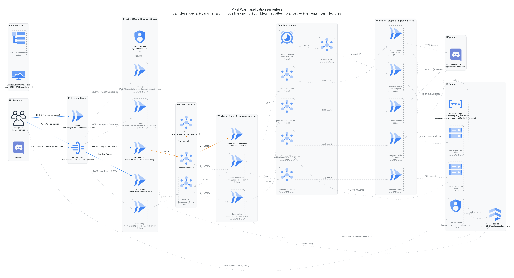
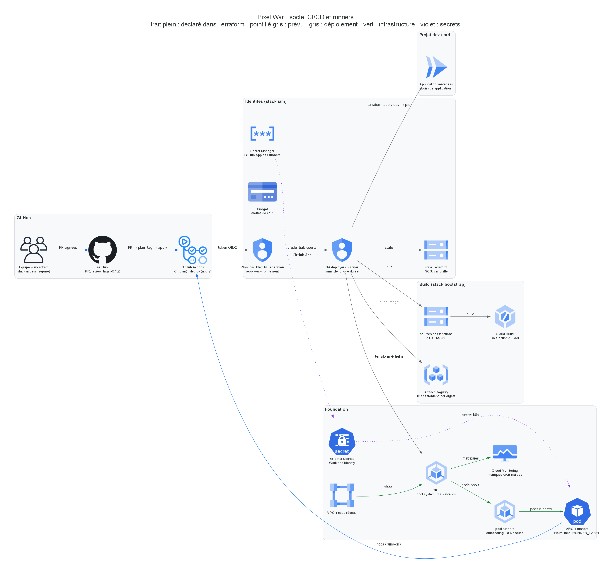

# Architecture

## Périmètre et références

L'application sépare l'entrée HTTP, le traitement événementiel et les données.
Les décisions détaillées sont dans [les ADR](adr/README.md) ; les modules et
workflows versionnés déterminent les ressources déclarées pour une installation.
Ce document décrit les responsabilités et contrats, pas un inventaire GCP.

## Diagramme

Le diagramme est écrit en code (`docs/architecture/diagram.py`, librairie
`diagrams` et icônes officielles GCP). Chaque composant y est relié aux adresses
Terraform qui l'implémentent, et son trait est déduit du code :

- **trait plein** : toutes ses ressources sont déclarées dans Terraform ;
- **pointillé gris, « prévu »** : au moins une ressource n'existe pas encore ;
- **sans ressource** : élément externe ou service managé (Discord, GitHub,
  navigateur, Cloud Logging/Monitoring/Trace).

Contrôles :

- la CI des PR (job `architecture diagram`) échoue si un composant déclaré dans
  Terraform (fonction, topic, bucket, service Cloud Run, cluster, release Helm…)
  n'est pas dessiné, ou si `architecture.json` n'est plus à jour ;
- chaque release (tag `v*`) génère les images du code publié, jointes au run
  Deploy en artefact ; aucun commit automatique.

Mettre à jour : modifier `COMPONENTS` et `FLOWS` dans `diagram.py`, lancer
`just diagram` puis commiter les PNG et `architecture.json`. Prérequis :
[Graphviz](https://graphviz.org/download/) et `pip install diagrams==0.25.1`.
`just diagram --check` ne demande que Python.

« Déclaré dans Terraform » ne prouve pas qu'une ressource est appliquée dans un
environnement : avant la soutenance, comparer aussi avec `terraform state list`
de chaque stack en prd (DOC-02).

## Composants et frontières

| Composant | Responsabilité | Frontière |
| --- | --- | --- |
| Frontend (Cloud Run) | Image nginx qui sert l'application React (ADR-0011) | Seul service public avec `realtime` ; aucun rôle GCP |
| API Gateway | Routage HTTP et validation du JWT de session des routes protégées (ADR-0012) | Point d'entrée HTTP des proxies |
| Service `realtime` (Cloud Run) | Flux SSE des deltas, état utilisateur et config (ADR-0013) | JWT de session vérifié dans le code ; lecture Firestore seule |
| Fonction proxy | Validation de la requête et publication de l'événement | Invocation IAM par l'identité Gateway |
| Pub/Sub | Distribution par topic/abonnement, retries et DLQ | Push OIDC avec une identité d'invocation dédiée |
| Fonction worker | Traitement durable et idempotent avant acquittement | Ingress interne, runtime distinct de l'invoker |
| Firestore | Tuiles, deltas, état utilisateur, config et déduplication (ADR-0007), index et TTL en Terraform | IAM seulement, par compte d'exécution ; aucun accès client, aucune règle |
| Secret Manager | Valeurs sensibles et versions | Accès runtime secret par secret |
| Sources GCS et Artifact Registry | Sources et images internes des fonctions | Identité de build distincte du runtime |
| GKE et ARC | Exécution et autoscaling des runners CI | Aucun hébergement du backend applicatif |

Les contrats de données, identité web, temps réel et hébergement sont décrits
respectivement par ADR-0007, ADR-0012, ADR-0013 et ADR-0011. Aucun produit
Firebase n'est utilisé (revue intermédiaire) : le navigateur ne parle jamais à
Firestore, ses lectures passent par la gateway et son temps réel par le service
`realtime`, dont l'accès direct reste **à valider** (ADR-0013). Les runbooks d'un composant déployable
doivent correspondre à ses modules et handlers, pas seulement à un ADR.

## Entrée HTTP et événements

API Gateway appelle les proxies avec son identité Google et l'audience de leur
URL de fonction. Les proxies autorisent cet accès réseau, mais pas l'invocation
anonyme. La validation JWT utilisateur à la Gateway et l'authentification IAM du
backend sont deux contrôles distincts.

Le callback Discord est public à la Gateway pour recevoir les requêtes Discord ;
le handler vérifie Ed25519 sur le corps brut. La [sonde hello](discord-hello.md)
répond directement pour tester ce contrat HTTP. Elle ne représente pas le
traitement événementiel des commandes métier.

Pour le flux métier, un proxy attend la publication avant de répondre. Pub/Sub
pousse ensuite vers le worker. Un 2xx acquitte le message ; une erreur technique
non-2xx permet le retry. La livraison est au moins une fois, sans ordre garanti :
les écritures et publications doivent traiter doublons et interruptions. Voir
ADR-0002 et le [contrat transactionnel des quotas](rate-limits.md).

## Sources et déploiement

Les sources TypeScript de la fonction et du paquet partagé sont regroupées par
esbuild ; les paquets npm restent externes. Terraform crée le ZIP, le téléverse
et référence sa génération GCS. Google construit l'image avec l'identité de build
et l'exécute avec celle du runtime.

ADR-0009 remplace le contrat de promotion d'archive d'ADR-0008 : chaque
environnement construit depuis le commit choisi, sans garantie de mêmes octets
ou de mêmes transitives installées. Le frontend et les services externes ont
leurs propres contrats ; une archive backend ne constitue pas leur déploiement.

Les responsabilités des stacks, l'initialisation des backends et l'ordre des
opérations sont décrits dans [Installation et déploiement](deployment.md).

Le [contrat proposé par ADR-0010](adr/0010-separation-gateway-serverless.md)
sépare les states `serverless` (fonctions) et `gateway` (entrée HTTP). Le second
consomme un contrat d'outputs après l'apply du premier ; sa création de config
avant suppression ne se propage donc pas dans le graphe des fonctions. Cette
séparation ne garantit pas l'absence d'interruption lors du remplacement d'une fonction.
