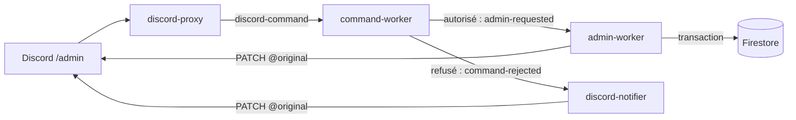

# Déploiement dev du parcours `/admin` (BOT-08, DATA-04)

Troisième étape de déploiement dev, après le [parcours `/draw`](deploy-draw-path.md)
et le [parcours web](deploy-web-path.md).

## Ce qui est déployé

| Ressource | Fichier | Détail |
| --- | --- | --- |
| `/admin` dans le proxy | `app/functions/discord-proxy/src/event.ts` | Sous-commande aplatie, réponse différée visible par son seul auteur (`flags: 64`), pseudo coupé à 32 caractères |
| `admin-worker` | `infra/serverless/admin-path.tf` | Timeout 180 s, `datastore.user`, secrets `discord-application-id` et `admin-allowlist` |
| Topics `admin-requested`, `command-rejected` | `infra/serverless/admin-path.tf` | Seul publisher : le `command-worker` |
| Abonnements | module `push-subscription` | `admin-worker` (210 s), `discord-notifier-command-rejected` (60 s), chacun avec sa DLQ |
| `--admin` | `app/tools/discord-commands` | Enregistre `/admin` seul, sans toucher `/draw` |

## Prérequis

1. Les parcours `/draw` et web sont validés en dev.
2. `admin-allowlist` contient au moins ton id Discord (version 1, déjà créée).
3. Après le deploy, enregistrer `/admin` depuis `app/` (procédure de
   [`docs/discord-commands.md`](discord-commands.md)) : aperçu avec `--admin`, puis
   `--admin --apply --confirm-application-id …`.

Retour en arrière : il n'y a pas de flag propre à l'admin. Pour couper `/admin`,
supprimer la commande dans Discord ; les ressources restent sans trafic.

## Checklist de test manuel

`/admin` n'apparaît qu'aux administrateurs du serveur (`default_member_permissions = "0"`).
Le refus se teste avec un compte qui a ce droit Discord mais n'est pas dans
`admin-allowlist`, ou en retirant temporairement ton id de l'allow-list (nouvelle
version du secret, puis redéploiement du `command-worker`).

| # | Étape | Résultat attendu | Fait (date) |
| --- | --- | --- | --- |
| 0 | Run `Deploy` terminé | Jobs verts ; `admin-worker` ACTIVE, 2 abonnements et leurs DLQ | |
| 1 | `/admin pause` | Réponse visible par toi seul : « Dessins suspendus… » ; `config/global.paused = true` | |
| 2 | `/draw` pendant la pause | Refus `paused` dans Discord | |
| 3 | `/admin resume` puis `/draw` | Dessin accepté | |
| 4 | `/admin ratelimit user:@toi limit:2`, puis 3 `/draw` dans la minute | Le 3e est refusé `rate_limit` ; `ratelimit_overrides/<id>` créé | |
| 5 | `/admin size width:20000` seul | Réponse immédiate : « Indique `width` et `height` ensemble… », rien de publié | |
| 6 | `/admin size width:20000 height:20000`, puis `/draw x:30000 y:0 color:1` | Refus `out_of_bounds` | |
| 7 | `/admin size` sans option | Grille infinie : `config/global.size = null` | |
| 8 | `/admin clear` | « Grille effacée : version 2 » ; `canvas_version = 2` ; anciennes tuiles purgées | |
| 9 | `/admin pause` par un non-admin de l'allow-list | Refus visible par lui seul ; `config/global` inchangé | |
| 10 | Remettre ta limite : `/admin ratelimit user:@toi limit:20` | Quota normal | |
| 11 | DLQ `admin-worker-dlq-inspect`, `discord-notifier-command-rejected-dlq-inspect` | Vides | |
