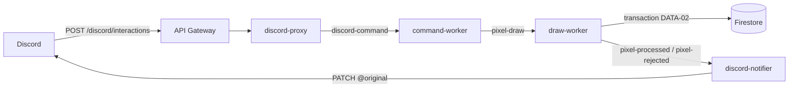

# Déploiement dev du parcours `/draw` (SRV-05)

Première des trois étapes de déploiement dev : `/draw` sur Discord, puis le web
(`web-proxy`, `tile-reader`), puis l'administration (`admin-worker`). Chaque étape
est testée à la main en dev avant la suivante.

## Ce qui est déployé

| Ressource | Fichier | Détail |
| --- | --- | --- |
| `command-worker` | `infra/serverless/discord-command.tf` | Remplace le worker de diagnostic `discord-command-verify`, supprimé |
| `draw-worker` | `infra/serverless/draw-path.tf` | `concurrency = 1`, 2 instances maximum, timeout 300 s, `roles/datastore.user` |
| `discord-notifier` | `infra/serverless/draw-path.tf` | Timeout 30 s, abonné à `pixel-processed` et `pixel-rejected` |
| Topics `pixel-draw`, `pixel-processed`, `pixel-rejected` | `infra/serverless/draw-path.tf` | Un seul publisher par topic : le runtime du producteur |
| 4 abonnements push, chacun avec sa DLQ | module `modules/push-subscription` | `command-worker`, `draw-worker`, `discord-notifier-processed`, `discord-notifier-rejected` |
| `config/global` | `infra/serverless/firestore.tf` | Créé une fois ; jamais réécrit par un apply suivant |
| Routage Gateway | `dev.tfvars` : `use_discord_proxy = true` | `/discord/interactions` passe de la sonde hello au proxy |

Paramètres communs à chaque abonnement (docs/events.md, section 7.2) : push OIDC
avec l'invoker dédié du worker, audience égale à son URI, retry de 10 à 60 s,
DLQ après environ 5 tentatives, rétention de 7 jours, abonnement
`<abonnement>-dlq-inspect` pour lire la DLQ.

| Abonnement | Délai d'acquittement | Timeout du worker |
| --- | --- | --- |
| `command-worker` | 60 s | 30 s |
| `draw-worker` | 330 s | 300 s |
| `discord-notifier-processed` / `-rejected` | 60 s | 30 s |

`config/global` est créé avec `paused = false`, `canvas_version = 1`,
`size = null` (grille infinie), `bounds = null` et `default_limit_per_minute = 20`.
`ignore_changes = [fields]` : un `/admin pause` ou `clear` n'est jamais annulé par
un déploiement. Pour réinitialiser, supprimer le document puis redéployer.

## Prérequis, avant de lancer le déploiement

À vérifier par Benjamin, sans afficher de valeur secrète :

1. **IAM dev à jour** (`infra/iam`, appliqué à la main) : le deployer doit avoir
   `roles/iam.serviceAccountAdmin`, `roles/pubsub.admin`, `roles/datastore.owner`
   et le `projectIamAdmin` conditionnel qui autorise `roles/datastore.user` (#136).
   Sans cela, l'apply échoue sur les attributions tokenCreator ou Firestore.
2. **Secret `admin-allowlist`, version 1** : le `command-worker` refuse de démarrer
   sans lui (`503`). Valeur attendue : `{"user_ids": ["<ton id Discord>"], "role_ids": []}`.
   Le conteneur existe déjà (`infra/iam/secrets.tf`) ; seule la version est à ajouter.
3. **Versions 1** de `discord-public-key` et `discord-application-id` actives
   (déjà utilisées par la sonde).
4. **URL d'interactions** de l'application Discord dev égale à
   `<gateway_url>/discord/interactions` (déjà le cas pour la sonde hello).

## Lancer le déploiement

Un merge dans `prod` ne déploie rien. Le workflow `Deploy` lancé à la main
(`workflow_dispatch`) ne déploie **que dev** : foundation et bootstrap, puis
serverless, gateway et frontend, puis le contrôle SEC-01 « rien de public ».

Un seul run applique tout : fonctions, topics, abonnements, puis la bascule de la
Gateway. L'ordre des dépendances Terraform crée les droits avant chaque abonnement,
et la sortie `gateway_contract` refuse la bascule sans livraison.

À relire dans le plan serverless avant l'apply :

- des créations pour les trois workers, les topics, les abonnements et leurs DLQ ;
- la **suppression** de `discord-command-verify`, de ses comptes, de son topic
  `discord-command-verify-dlq` et de son abonnement d'inspection (créés par l'apply
  partiel du 18/11) ;
- aucune modification de `discord-hello` ni de l'`auth-proxy`.

## Revenir en arrière

Remettre seulement `use_discord_proxy = false` et redéployer : la Gateway revient
sur la sonde hello. Ne jamais passer `enable_discord_delivery` ni
`enable_discord_pipeline` à `false` : cela supprimerait les abonnements et les
messages qu'ils contiennent.

## Checklist de test manuel

À remplir pendant l'essai. Ne cocher qu'une ligne réellement exécutée, avec sa date.
Les logs sont dans Cloud Logging, filtrés par `resource.labels.service_name`.

| # | Étape | Résultat attendu | Où vérifier | Fait (date) |
| --- | --- | --- | --- | --- |
| 0 | Run `Deploy` terminé | Jobs serverless, gateway et `no-public-dev` verts | GitHub Actions | |
| 1 | Fonctions | `discord-proxy`, `command-worker`, `draw-worker`, `discord-notifier` ACTIVE | Console Cloud Run functions | |
| 2 | Abonnements | 4 abonnements push et 4 `-dlq-inspect`, DLQ vides | Console Pub/Sub | |
| 3 | `config/global` | Les 5 champs ci-dessus | Console Firestore | |
| 4 | Appel direct d'un worker sans token | `403` | `curl` sur l'URI `run.app` | |
| 5 | Requête mal signée sur `/discord/interactions` | `401` | `curl` sur la Gateway | |
| 6 | Enregistrer `/draw` | `npm run discord:commands -- --draw`, puis avec `--apply` après relecture | [CLI](discord-commands.md) | |
| 7 | `/draw x:0 y:0 color:5` | Message différé, puis « pixel posé » en quelques secondes | Discord | |
| 8 | Trace du `/draw` | Logs des 4 fonctions avec le même `correlation_id` | Cloud Logging | |
| 9 | Firestore après le dessin | `tile_colors`, `tile_metadata`, `deltas`, `processed_events` et `users/<id>` créés | Console Firestore | |
| 10 | Rejouer le même pixel avec une autre couleur | Couleur remplacée (last-write-wins) | Discord, Firestore | |
| 11 | Dépasser le quota (21 `/draw` en moins d'une minute) | Refus `rate_limit` avec le délai | Discord | |
| 12 | Coordonnée hors limites (`x:2000000000`) | Discord refuse la valeur avant l'envoi (bornes de la définition `/draw`) | Discord | |
| 13 | DLQ après les essais | Toujours vides | Console Pub/Sub | |
| 14 | Temps de réponse | Réponse différée sous 3 s à froid et à chaud | Logs du proxy | |

Hors de cette étape : routes web, `/admin` (le `command-worker` n'a pas encore de
topic admin, `/admin` n'est d'ailleurs pas transmis par le proxy), `/get`,
`/snapshot`, alertes DLQ (OBS).
