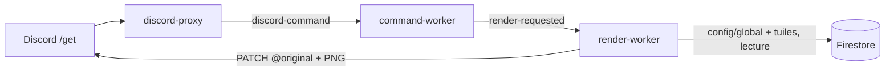

# Déploiement dev du parcours `/get` (BOT-06)

Quatrième étape de déploiement dev, après les parcours [`/draw`](deploy-draw-path.md),
[web](deploy-web-path.md) et [`/admin`](deploy-admin-path.md).

## Ce qui est déployé

| Ressource | Fichier | Détail |
| --- | --- | --- |
| `/get` dans le proxy | `app/go/discord-proxy/event.go` (référence `app/functions/discord-proxy/src/event.ts`) | Sans option ; réponse différée publique `{ "type": 5 }` |
| Topic `render-requested` | `infra/serverless/render-path.tf` | Seul publisher : le `command-worker` (`RENDER_REQUESTED_TOPIC`) |
| `render-worker` | `infra/serverless/render-path.tf` | 1 Gio, une requête par instance, timeout 300 s, `datastore.viewer`, secret `discord-application-id` |
| Abonnement | module `push-subscription` | `render-worker`, délai d'acquittement 330 s, DLQ |
| Envoi de l'image | `app/shared/src/discord/original-response.ts` | `PATCH @original` en multipart (`payload_json` + `files[0]`), timeout 30 s |
| `--get` | `app/tools/discord-commands` | Enregistre `/get` seul, sans toucher les autres commandes |

## Ce que rend `/get`

- La zone peinte de la version courante de la grille (`config/global.bounds`),
  coupée à la grille si elle est bornée (`/admin size`).
- Une image de 2048 px de côté au plus : au-delà, 1 pixel de l'image représente
  2, 4, 8… pixels de la grille (un pixel coloré l'emporte sur le blanc). L'image est
  encore divisée par deux tant qu'elle dépasse 9,5 Mio (limite d'upload Discord).
- Rien de peint : « La toile est vide… », sans image.
- Plus de 65 536 tuiles de 64 × 64 à lire (zone de plus de 16 384 px de côté à pleine
  résolution) : « La zone peinte est trop grande… », sans image. La vue éloignée
  (DATA-05c) lèvera cette limite ; en attendant, `/admin size` borne la zone rendue.
- Une nouvelle livraison du même message modifie la même réponse et remplace son
  image : jamais deux images pour un `/get`.

## Prérequis

1. Les parcours `/draw` et `/admin` sont validés en dev.
2. Pas d'apply `infra/iam` : aucune nouvelle API ni nouveau rôle du deployer.
3. Après le deploy, enregistrer `/get` depuis `app/` : aperçu avec `--get`, puis
   `--get --apply --confirm-application-id …` ([`docs/discord-commands.md`](discord-commands.md)).

## Checklist de test manuel

| # | Étape | Résultat attendu | Fait (date) |
| --- | --- | --- | --- |
| 0 | Run `Deploy` terminé | Jobs verts ; `render-worker` ACTIVE, abonnement `render-worker` et sa DLQ | |
| 1 | Enregistrer `/get` (`--get`) | Seule `/get` est créée ; `/draw` et `/admin` inchangées | |
| 2 | `/get` sur une grille où tu as dessiné | Image PNG jointe ; texte « Zone peinte de (…) à (…) » ; pixels aux bonnes couleurs | |
| 3 | `/draw` d'un pixel bien visible, puis `/get` | Le nouveau pixel apparaît | |
| 4 | `/admin size width:10000 height:10000` avec un pixel peint au-delà, puis `/get` | Le pixel hors grille n'est pas rendu ; `/admin size` pour revenir | |
| 5 | Logs `render-worker` | `render.image` avec `correlation_id`, aucun token ; trace reliée au proxy | |
| 6 | DLQ `render-worker-dlq-inspect` | Vide | |
| 7 | (après un `/admin clear` de fin de test) `/get` | « La toile est vide… » | |
