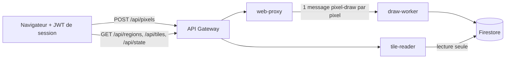

# Déploiement dev du parcours web (DRAW-01, SRV-11)

Deuxième des trois étapes de déploiement dev, après le [parcours `/draw`](deploy-draw-path.md)
et avant l'administration. Elle réutilise le `draw-worker`, le topic `pixel-draw`
et `config/global` de la première étape.

## Ce qui est déployé

| Ressource | Fichier | Détail |
| --- | --- | --- |
| `web-proxy` | `infra/serverless/web-path.tf` | Proxy privé, timeout 15 s, 3 instances maximum, publisher sur `pixel-draw` seulement |
| `tile-reader` | `infra/serverless/web-path.tf` | Proxy privé, timeout 15 s, `roles/datastore.viewer` |
| Backends `api` et `tiles` | `infra/serverless/gateway-backends.tf` | Exportés dans `gateway_contract` |
| Routes | `infra/gateway/routes.tf` | `POST /api/pixels`, `GET /api/regions/{rx}/{ry}/tiles`, `GET /api/tiles/{tx}/{ty}/meta`, `GET /api/state` : JWT de session, preflight CORS |
| Paramètres de chemin | `modules/api-gateway` | Chaque `{nom}` est déclaré en paramètre `path` (OpenAPI 2.0) |
| Activation | `dev.tfvars` : `enable_web_api = true` | Refusée sans le pipeline `/draw` et sa livraison |

`FRONTEND_ORIGIN` des deux proxies est l'URL déterministe du frontend
(`https://frontend-<numéro de projet>.<région>.run.app`), comme pour l'`auth-proxy`.

## Prérequis

1. Le parcours `/draw` est déployé et sa checklist est passée.
2. Le frontend et l'`auth-proxy` sont déployés, pour obtenir un JWT de session
   par la connexion Discord.

## Lancer le déploiement et revenir en arrière

Même workflow `Deploy` (dev seulement). Le plan serverless doit montrer deux
fonctions et leurs comptes créés, et un droit publisher ajouté sur `pixel-draw` ;
le plan gateway, une nouvelle configuration d'API.

Retour en arrière : `enable_web_api = false`. Les deux fonctions sont supprimées
et leurs routes retirées de la gateway ; aucune file de messages n'est touchée.

## Checklist de test manuel

Le JWT de session se récupère après connexion sur le frontend (outils de
développement du navigateur). C'est un credential : ne jamais le coller dans un
chat, une PR ou un log. Dans un terminal : `export TOKEN=...` puis
`GW=<gateway_url>`.

| # | Étape | Résultat attendu | Fait (date) |
| --- | --- | --- | --- |
| 0 | Run `Deploy` terminé | Jobs serverless, gateway et `no-public-dev` verts | |
| 1 | Fonctions | `web-proxy` et `tile-reader` ACTIVE | |
| 2 | `curl -i $GW/api/state` sans token | `401` renvoyé par la gateway, sans log dans `tile-reader` | |
| 3 | Appel direct de l'URL `run.app` du `web-proxy` | `403` | |
| 4 | `curl -H "Authorization: Bearer $TOKEN" $GW/api/state` | `200`, `canvas_version = 1`, quota restant | |
| 5 | `POST $GW/api/pixels` avec `{"pixels":[{"x":10,"y":10,"color":3}]}` | `202` avec `correlation_id` et un `event_id` | |
| 6 | Logs du parcours | `web-proxy` puis `draw-worker` avec le même `correlation_id` | |
| 7 | `GET $GW/api/regions/0/0/tiles` avec `--compressed -i` | `200`, binaire, `ETag`, `Content-Encoding: gzip` | |
| 8 | Même requête avec `If-None-Match: <ETag>` | `304` | |
| 9 | `GET $GW/api/tiles/0/0/meta` | Pseudo et date du pixel, jamais l'id Discord | |
| 10 | Région négative : `GET $GW/api/regions/-1/-1/tiles` | `200` (vide) : les paramètres négatifs passent la gateway | |
| 11 | `POST` de 3 pixels dont 2 identiques | `400 duplicate_pixel` | |
| 12 | Preflight `OPTIONS` depuis l'origine du frontend | `204`, `Access-Control-Allow-Origin` égal au frontend | |
| 13 | Origine différente | Pas d'en-tête CORS | |
| 14 | DLQ `draw-worker-dlq-inspect` | Toujours vide | |

Points du ticket à vérifier en dev : format réel de `X-Apigateway-Api-Userinfo`
(étapes 4 et 5), transmission de `ETag`, `304` et gzip par la gateway (7 et 8),
latence de publication à froid.
