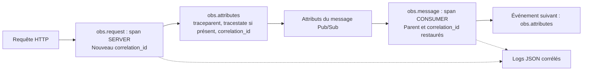

# SRV-08 — Observabilité commune des services

## Périmètre et décisions

Bibliothèque **serveur uniquement** dans `app/shared/src/observability` :
logs JSON vers stdout, spans manuels par requête/message, contexte W3C et métriques
métier. Aucun démarrage réseau ou SDK lors d'un simple import.
Elle ne doit pas entrer dans le bundle du frontend.

OpenTelemetry est demandé par #38. L'export retenu est **OTLP HTTP/protobuf** vers
la Telemetry API GCP, avec ADC et rafraîchissement des tokens. Les anciens paquets
`@google-cloud/opentelemetry-cloud-*-exporter` annoncent leur dépréciation et leur
archivage après le 30 octobre 2026 : ils ne sont pas introduits ici.
La bibliothèque utilise la famille SDK OpenTelemetry 3 / exporteurs 0.300 et API
1.10 ; les versions sont fixées dans le lockfile, sans forcer les peer dependencies.

Le logger JSON minimal évite un SDK Cloud Logging et une seconde chaîne réseau :
Cloud Run collecte stdout. Pino ou Winston pourraient remplacer ce formateur si
les besoins dépassent ce schéma restreint (niveaux filtrables, redaction ou transports).
Ce choix ne revendique pas de gain de performance mesuré.

Un Collector Cloud Run est une autre option recommandée par Google lorsque
l'environnement s'y prête ; il ajouterait un composant à déployer/configurer.
L'export direct est retenu pour ce premier socle. Aucun Collector applicatif ne
doit être installé sur le GKE réservé aux runners.

## Contrat de propagation (à brancher dans les futurs services)



Ce schéma décrit l'API de la bibliothèque, pas un flux métier déjà déployé.

## Initialisation : une instance par processus de service

```ts
import { createGoogleObservability } from '@pixelwar/shared/observability/google';

const obs = await createGoogleObservability({
  serviceName: 'discord-proxy',
  projectId: 'cloud-pixelwar-dev', // injecter le projet de l'environnement
  environment: 'dev',
  region: 'europe-west1',
  serviceVersion: 'v1.0.0',       // injecter la version de release
  samplingRatio: 1,              // valeur initiale, à mesurer puis ajuster
});
```

ADC utilise l'identité d'exécution Cloud Run, sans fichier de clé. Les headers
d'authentification sont redemandés avant les exports pour renouveler les tokens.
Les URLs d'export GCP sont fixes : aucune redirection des credentials par un endpoint
provenant d'une requête. Le délai des exports est borné et les métriques sont
fractionnées en lots de 200 points maximum.

En local, utiliser `createObservability` avec des exporteurs en mémoire ou sans
exporteur (logs uniquement). Sans exporteur, aucune donnée de trace/métrique n'est
envoyée ; ce n'est pas un mode de production instrumenté complet.

Le paquet expose des **sources TypeScript**, comme le workspace initial.
SRV-02 devra les compiler ou les bundler dans les images ; ces exemples ne sont
pas une promesse d'exécution directe par Node des imports TypeScript actuels.

## Proxy : générer, publier puis répondre

Dans le handler HTTP (adapter le framework et le SDK Pub/Sub) :

```ts
const result = await obs.request('POST /api/pixels', {
  traceparent: request.headers.traceparent,
  tracestate: request.headers.tracestate,
}, async ({ correlationId }) => {
  // Authentification/validation puis publication uniquement, pas d'écriture métier.
  await topic.publishMessage({
    data: Buffer.from(JSON.stringify(event)),
    attributes: obs.attributes(),
  });
  obs.log('INFO', 'Drawing queued', { event_type: 'pixel-draw', user_id: userId });
  return { correlation_id: correlationId };
});
```

Les en-têtes HTTP doivent être normalisés en chaînes simples par le handler.
Un `correlation_id` client n'est pas repris ; un contexte W3C valide peut être
continué. Un message interne conserve son ID valide, sinon reçoit un UUID.
Un `traceparent` invalide démarre une nouvelle trace.
Le contexte est extrait depuis ROOT pour ne jamais récupérer celui d'un autre
message concurrent. Le baggage n'est ni extrait ni propagé.

## Worker : restaurer, traiter et propager

```ts
await obs.message('pixel-draw', pushBody.message.attributes ?? {}, async () => {
  await commitPixels(event); // traitement métier à implémenter dans DRAW-02
  obs.pixels.processed(event.pixels.length, event.source);
  obs.pixels.latency(event.occurred_at); // appeler après le commit réel
  await nextTopic.publishMessage({
    data: Buffer.from(JSON.stringify(nextEvent)),
    attributes: obs.attributes(),
  });
});
```

Une erreur technique marque le span ERROR, écrit un log générique, termine le
span puis **relance l'erreur**. Le handler doit répondre en erreur pour les retries
Pub/Sub. Un rejet métier attendu ne doit pas être une exception technique :
enregistrer `obs.pixels.rejected(count, source, reason)`, publier le rejet et
répondre 2xx conformément à ADR-0002.
Noms d'opérations : routes et types d'événements stables, jamais une URL contenant
des paramètres sensibles ou un nom de span par utilisateur.

Les providers/context managers sont propres à cette instance ; ils ne remplacent
pas les providers globaux OpenTelemetry du processus. Cela évite les effets de
bord, mais signifie que les spans des SDK tiers ne sont pas automatiquement reliés.
Une auto-instrumentation future nécessite une décision de bootstrap cohérente :
ne pas installer un second SDK global au hasard.

## Logs et données sensibles

Champs : `timestamp`, `severity`, `message`, `function`, `event_type`,
`correlation_id`, `user_id`. Les champs contextuels absents valent `null`.
Avec un span valide : `logging.googleapis.com/trace` au format
`projects/<projet>/traces/<traceId>`, `logging.googleapis.com/spanId` et
`logging.googleapis.com/trace_sampled`.

Seuls les champs documentés sont copiés. Les objets Error, corps HTTP, headers,
tokens Discord et payloads complets ne sont pas sérialisés automatiquement.
Le marqueur d'erreur générique privilégie l'absence de fuite, au prix de diagnostics
moins détaillés ; ajouter ultérieurement des codes d'erreur validés, pas le message
brut d'une dépendance.
Le développeur peut toujours mettre un secret dans une chaîne `message` : **ne
jamais le faire**. Ce logger n'est pas un détecteur automatique de secrets.

## Métriques exposées

| Instrument | Type / unité | Attributs |
| --- | --- | --- |
| `pixelwar.pixels.processed` | Compteur / pixels | `source` : web ou discord |
| `pixelwar.pixels.rejected` | Compteur / pixels | `source`, `reason` : paused, rate_limit, invalid_pixel, unauthorized |
| `pixelwar.draw.end_to_end` | Histogramme / secondes | Aucun identifiant utilisateur |

Pas de `user_id`, coordonnées, message ID ou correlation ID dans les labels :
ils multiplieraient le nombre de séries et les coûts. Un compteur porte sur les
pixels, pas sur les requêtes. Les quantités et raisons sont contrôlées à l'exécution.
Une date invalide ou future est refusée pour la latence ; une arrivée tardive
valide peut naturellement produire une grande latence.

La métrique de latence doit rester fiable sans faire rejouer une écriture déjà
committée à cause d'une date invalide : valider l'enveloppe événementielle en amont
et traiter les erreurs d'observabilité sans transformer un succès métier en échec.
Ces compteurs ne remplacent pas un audit transactionnel ni l'idempotence DATA-02.
Les retries/réplicas peuvent influer sur les observations si le worker compte mal.

Avec l'ingestion OTLP Google, les métriques apparaissent normalement sous
`prometheus.googleapis.com/`, pas le préfixe historique `workload.googleapis.com/`.
Les noms sont convertis par Google ; vérifier les types réels dans Metrics Explorer
avant d'écrire les dashboards/alertes DRAW-05 et OBS-02.

## Cloud Run : exporter avant de répondre

Le module Cloud Run utilise `cpu_idle = true`. Ne pas compter uniquement sur les
timers d'export en arrière-plan lorsque la requête est terminée.
Après `obs.request`/`obs.message`, appeler et attendre `obs.flush()` **avant** la
réponse HTTP/ack Pub/Sub. Le span est alors terminé et peut être exporté.
Les erreurs d'export ne doivent pas transformer un traitement métier réussi en
retry : les intercepter et produire un log sûr, sans répéter l'opération métier.

```ts
try {
  await obs.flush();
} catch {
  obs.log('WARNING', 'Telemetry flush failed');
}
// Puis envoyer la réponse HTTP déjà déterminée par le résultat métier.
```

Les exporteurs peuvent signaler certaines erreurs via les diagnostics internes
sans rejeter `forceFlush` : sa résolution ne prouve pas une ingestion réussie GCP.
Le flush augmente la latence et peut participer au délai de 3 s Discord ; le
mesurer sur le proxy et revoir batching/Collector si nécessaire. Ne pas supprimer
simplement le flush et continuer en arrière-plan après la réponse.

À l'arrêt, le point d'entrée du service doit arrêter d'accepter des requêtes,
attendre celles en cours puis appeler `obs.shutdown()`, notamment sur SIGTERM.
La bibliothèque n'installe pas de handler global ni de `process.exit` à l'import.

## Infrastructure et coûts

Le bootstrap active Logging, Monitoring, Trace et Telemetry (sans les désactiver
au destroy). Le module service conserve les trois rôles demandés par #38 et ajoute
`roles/telemetry.tracesWriter` pour l'ingestion OTLP. Si un quota project ADC
distinct est configuré, vérifier également `serviceusage.services.use` sur ce
projet ; ne pas distribuer des droits supplémentaires sans besoin démontré.

Ces attributions sont à l'identité runtime, pas aux utilisateurs finaux. Aucun
service n'est exposé publiquement par ce changement et aucune clé n'est ajoutée.
Les exports entraînent trafic, latence, consommation CPU et ingestion facturable.
La fréquence métrique est 60 s ; l'échantillonnage traces est configurable et respecte
le sampling du parent W3C. Évaluer les coûts et le volume avant charge/démonstration.

## Validation et limites actuelles

Depuis `app/` : `npm run typecheck`, `npm run test:coverage`, `npm run test:integration`.
Les tests vérifient parenté proxy/worker, corrélation des logs, concurrence,
erreurs, métriques, paramètres OTLP et renouvellement des headers simulé.
Un test d'intégration envoie de vrais lots OTLP/protobuf à un récepteur HTTP local.
Les tests Terraform vérifient les ressources et le rôle supplémentaire.

**Pas encore prouvé :** réception réelle des données par GCP, mapping exact des
métriques, permissions runtime effectives et latence du flush sous Cloud Run.
SRV-09 doit montrer un log, une trace et des métriques sur dev avec l'identité
réelle. Aucun proxy ni worker métier n'est instrumenté tant qu'il n'utilise pas
explicitement ces wrappers.

## Sources (consultées le 29 octobre 2026)

- [OpenTelemetry JS : instrumentation manuelle](https://opentelemetry.io/docs/languages/js/instrumentation/).
- [Google : dépréciation des exporteurs et migration OTLP](https://github.com/GoogleCloudPlatform/opentelemetry-operations-js/blob/main/MIGRATION.md).
- [Google : export OTLP de métriques depuis les SDK](https://docs.cloud.google.com/stackdriver/docs/otlp-metrics/use-sdks).
- [Google : exemple Node.js et alternatives Collector/direct](https://docs.cloud.google.com/stackdriver/docs/instrumentation/setup/nodejs).
- [Cloud Logging : logs structurés](https://docs.cloud.google.com/logging/docs/structured-logging).
