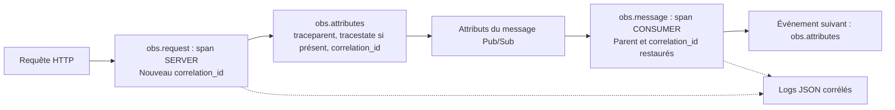

# Observabilité des fonctions

## Périmètre et décisions

Bibliothèque **serveur uniquement** dans `app/shared/src/observability` :
logs JSON vers stdout, spans manuels par requête/message, contexte W3C et métriques
métier. Aucun démarrage réseau ou SDK lors d'un simple import.
Elle ne doit pas entrer dans le bundle du frontend.

L'export retenu est **OTLP HTTP/protobuf** vers la Telemetry API GCP, avec ADC et
rafraîchissement des tokens. Les exporteurs directs historiques
`@google-cloud/opentelemetry-cloud-*-exporter` ne sont pas utilisés ; consulter
la référence de migration OpenTelemetry Google pour les contraintes d'export.
La bibliothèque utilise la famille SDK OpenTelemetry 3 / exporteurs 0.300 et API
1.10 ; les versions sont fixées dans le lockfile, sans forcer les peer dependencies.

Le logger JSON minimal évite un SDK Cloud Logging et une seconde chaîne réseau :
Cloud Run collecte stdout. Pino ou Winston pourraient remplacer ce formateur si
les besoins dépassent ce schéma restreint (niveaux filtrables, redaction ou transports).
Ce choix ne revendique pas de gain de performance mesuré.

Un Collector Cloud Run est une autre option recommandée par Google lorsque
l'environnement s'y prête ; il ajouterait un composant à déployer/configurer.
L'export direct est utilisé par la bibliothèque. Aucun Collector applicatif ne
doit être installé sur le GKE réservé aux runners.

## Contrat de propagation



Ce schéma représente le contrat des wrappers ; leur utilisation par un handler
détermine les traces et attributs effectivement émis.

## Initialisation : une instance par processus de service

```ts
import { createGoogleObservability } from '@pixelwar/shared/observability/google';

const obs = await createGoogleObservability({
  serviceName: 'discord-proxy',
  projectId: 'cloud-pixelwar-dev', // injecter le projet de l'environnement
  environment: 'dev',
  region: 'europe-west1',
  serviceVersion: 'v1.0.0',       // injecter la version de release
  samplingRatio: 1,              // valeur initiale, à mesurer puis ajuster
});
```

ADC utilise l'identité d'exécution Cloud Run, sans fichier de clé. Les headers
d'authentification sont redemandés avant les exports pour renouveler les tokens.
Les URLs d'export GCP sont fixes : aucune redirection des credentials par un endpoint
provenant d'une requête. Le délai des exports est borné et les métriques sont
fractionnées en lots de 200 points maximum.

En local, utiliser `createObservability` avec des exporteurs en mémoire ou sans
exporteur (logs uniquement). Sans exporteur, aucune donnée de trace/métrique n'est
envoyée ; ce n'est pas un mode de production instrumenté complet.

Le paquet expose des **sources TypeScript**. Le [build des fonctions](functions.md)
les regroupe dans le JavaScript livré à Cloud Build ; ces exemples ne supposent
pas une exécution directe des imports TypeScript par le runtime.

## Proxy : générer, publier puis répondre

Dans le handler HTTP (adapter le framework et le SDK Pub/Sub) :

```ts
const result = await obs.request('POST /api/pixels', {
  traceparent: request.headers.traceparent,
  tracestate: request.headers.tracestate,
}, async ({ correlationId }) => {
  // Authentification/validation puis publication uniquement, pas d'écriture métier.
  await topic.publishMessage({
    data: Buffer.from(JSON.stringify(event)),
    attributes: obs.attributes(),
  });
  obs.log('INFO', 'Drawing queued', { event_type: 'pixel-draw', user_id: userId });
  return { correlation_id: correlationId };
});
```

Les en-têtes HTTP doivent être normalisés en chaînes simples par le handler.
Un `correlation_id` client n'est pas repris ; un contexte W3C valide peut être
continué. Un message interne conserve son ID valide, sinon reçoit un UUID.
Un `traceparent` invalide démarre une nouvelle trace.
Le contexte est extrait depuis ROOT pour ne jamais récupérer celui d'un autre
message concurrent. Le baggage n'est ni extrait ni propagé.

## Worker : restaurer, traiter et propager

```ts
await obs.message('pixel-draw', pushBody.message.attributes ?? {}, async () => {
  const result = await commitPixels(event); // opération métier de l'appelant
  // Observation du résultat durable, pas un compteur de pixels uniques.
  obs.functions.drawResult(result);
  await nextTopic.publishMessage({
    data: Buffer.from(JSON.stringify(nextEvent)),
    attributes: obs.attributes(),
  });
});
```

Une erreur technique marque le span ERROR, écrit un log générique, termine le
span puis **relance l'erreur**. Le handler doit répondre en erreur pour les retries
Pub/Sub. Un rejet métier attendu ne doit pas être une exception technique :
enregistrer `obs.pixels.rejected(count, source, reason)`, publier le rejet et
répondre 2xx conformément à ADR-0002.
Noms d'opérations : routes et types d'événements stables, jamais une URL contenant
des paramètres sensibles ou un nom de span par utilisateur.

Les providers/context managers sont propres à cette instance ; ils ne remplacent
pas les providers globaux OpenTelemetry du processus. Cela évite les effets de
bord, mais signifie que les spans des SDK tiers ne sont pas automatiquement reliés.
L'ajout d'une auto-instrumentation exige un bootstrap cohérent :
ne pas installer un second SDK global au hasard.

## Logs et données sensibles

Champs : `timestamp`, `severity`, `message`, `function`, `event_type`,
`correlation_id`, `user_id`. Les champs contextuels absents valent `null`.
Avec un span valide : `logging.googleapis.com/trace` au format
`projects/<projet>/traces/<traceId>`, `logging.googleapis.com/spanId` et
`logging.googleapis.com/trace_sampled`.

Seuls les champs documentés sont copiés. Les objets Error, corps HTTP, headers,
tokens Discord et payloads complets ne sont pas sérialisés automatiquement.
Le marqueur d'erreur générique privilégie l'absence de fuite, au prix de diagnostics
moins détaillés ; ajouter ultérieurement des codes d'erreur validés, pas le message
brut d'une dépendance.
Le développeur peut toujours mettre un secret dans une chaîne `message` : **ne
jamais le faire**. Ce logger n'est pas un détecteur automatique de secrets.

## Métriques exposées

| Instrument | Type / unité | Attributs |
| --- | --- | --- |
| `pixelwar.pixels.processed` | Compteur / pixels | `source` : web ou discord |
| `pixelwar.pixels.rejected` | Compteur / pixels | `source`, `reason` : paused, rate_limit, invalid_pixel, unauthorized |
| `pixelwar.draw.end_to_end` | Histogramme / secondes | Aucun identifiant utilisateur |

Ces instruments historiques restent disponibles dans la bibliothèque. Le parcours
`/draw` utilise les observations de tentatives/résultats décrites ci-dessous,
pour ne pas présenter une relivraison comme un nouveau pixel métier unique.

Pas de `user_id`, coordonnées, message ID ou correlation ID dans les labels :
ils multiplieraient le nombre de séries et les coûts. Un compteur porte sur les
pixels, pas sur les requêtes. Les quantités et raisons sont contrôlées à l'exécution.
Une date invalide ou future est refusée pour la latence ; une arrivée tardive
valide peut naturellement produire une grande latence.

La métrique de latence doit rester fiable sans faire rejouer une écriture déjà
committée à cause d'une date invalide : valider l'enveloppe événementielle en amont
et traiter les erreurs d'observabilité sans transformer un succès métier en échec.
Ces compteurs ne remplacent pas un audit transactionnel ni l'idempotence DATA-02.
Les retries/réplicas peuvent influer sur les observations si le worker compte mal.

Avec l'ingestion OTLP Google, les métriques apparaissent normalement sous
`prometheus.googleapis.com/`, pas le préfixe historique `workload.googleapis.com/`.
Les noms sont convertis par Google ; vérifier les types réels dans Metrics Explorer
avant d'écrire les dashboards/alertes DRAW-05 et OBS-02.

## Cloud Run : exporter avant de répondre

Le contrat des Cloud Run functions impose de terminer le travail avant la réponse.
Ne pas compter uniquement sur les timers d'export en arrière-plan lorsque la
requête est terminée.
Après `obs.request`/`obs.message`, appeler et attendre `obs.flushRequest()` **avant** la
réponse HTTP/ack Pub/Sub. Le span est alors terminé et peut être exporté.
`createFunctionTelemetry` le fait déjà pour chaque requête.

`flushRequest()` n'est pas un `forceFlush` complet à chaque requête :

- **Traces** : les requêtes simultanées d'une instance partagent un seul export.
  Une requête rejoint l'export en cours, ou l'unique export mis en attente derrière
  lui, qui part après la fin de son span. 128 requêtes à la fois font au plus
  2 exports au lieu de 128.
- **Métriques** : au plus un export toutes les 10 s par instance
  (`metricFlushIntervalMillis`). Cloud Monitoring refuse les points d'une même série
  écrits plus souvent (`FAILED_PRECONDITION`, d'où les `telemetry.export_failed`
  mesurés en dev le 27/11). Les valeurs sont cumulatives : l'export suivant porte
  ce qu'un export sauté aurait envoyé.
- `obs.flush()` reste l'export complet et immédiat (tests, arrêt).
Les erreurs d'export ne doivent pas transformer un traitement métier réussi en
retry : les intercepter et produire un log sûr, sans répéter l'opération métier.

```ts
try {
  await obs.flushRequest();
} catch {
  obs.log('WARNING', 'Telemetry flush failed');
}
// Puis envoyer la réponse HTTP déjà déterminée par le résultat métier.
```

Les exporteurs peuvent signaler certaines erreurs via les diagnostics internes
sans rejeter `forceFlush` : sa résolution ne prouve pas une ingestion réussie GCP.
Le flush augmente la latence et peut participer au délai de 3 s Discord ; le
mesurer sur le proxy et revoir batching/Collector si nécessaire. Ne pas supprimer
simplement le flush et continuer en arrière-plan après la réponse.

À l'arrêt, le point d'entrée de la fonction doit arrêter d'accepter des requêtes,
attendre celles en cours puis appeler `obs.shutdown()`, notamment sur SIGTERM.
La bibliothèque n'installe pas de handler global ni de `process.exit` à l'import.

## Infrastructure et coûts

Le stack `iam` active Logging, Monitoring, Trace et Telemetry sans désactiver les
APIs lors d'un destroy. Le module `function` attribue au runtime
`logging.logWriter`, `cloudtrace.agent`, `monitoring.metricWriter` et
`telemetry.tracesWriter`. Si un projet de quota ADC
distinct est configuré, vérifier également `serviceusage.services.use` sur ce
projet ; ne pas distribuer des droits supplémentaires sans besoin démontré.

Ces attributions concernent l'identité runtime, pas les utilisateurs finaux, et
ne créent aucun droit d'invocation anonyme. L'export utilise ADC, sans clé JSON.
Les exports entraînent trafic, latence, consommation CPU et ingestion facturable.
La fréquence métrique est 60 s ; l'échantillonnage traces est configurable et respecte
le sampling du parent W3C. Évaluer les coûts et le volume avant une montée en charge.

## Vérification locale

Depuis `app/` : `npm run typecheck`, `npm run test:coverage`, `npm run test:integration`.
Les tests vérifient parenté proxy/worker, corrélation des logs, concurrence,
erreurs, métriques, paramètres OTLP et renouvellement des headers simulé.
Un test d'intégration envoie de vrais lots OTLP/protobuf à un récepteur HTTP local.
Les tests Terraform vérifient les ressources et le rôle supplémentaire.

Les tests locaux ne prouvent pas la réception par GCP ni les droits runtime.

## Instrumentation des fonctions du parcours draw

`discord-proxy`, `command-worker`, `draw-worker` et `discord-notifier` utilisent
`@pixelwar/shared/observability/function`. Une instance SDK est initialisée
paresseusement et réutilisée par processus. Les sondes hello et diagnostic
restent distinctes ; le lecteur de diagnostic accepte les flags W3C `00` et `01`.

```ts
const telemetry = createFunctionTelemetry('draw-worker', { writeLog: write });
await telemetry.message('pixel-draw', validatedAttributes, async (operation) => {
  operation.source(command.source);
  const result = await processDraw(command);
  operation.drawResult(result);
  await publish(resultEvent, operation.attributes());
  operation.outcome(result.type === 'pixel-rejected' ? 'rejected' : 'published', result.reason ?? 'none');
  write(JSON.stringify({ event_type: 'draw.result.published', ...operation.logFields() }) + '\n');
}); // flush terminé avant la réponse HTTP
```

Le proxy commence un span SERVER **après validation Ed25519 et validation de la
commande**. Il ne reprend aucun header de trace public et utilise l'ID de commande
stable comme corrélation de confiance. Le quatrième argument optionnel de
`obs.request` est réservé à cet ID déjà validé ; ne jamais y passer une entrée
publique non vérifiée. Les workers ouvrent des spans CONSUMER à partir des deux
attributs de message validés, puis publient le contexte de leur propre span.
Un retry garde l'ID métier et la corrélation, mais possède un nouvel ID de span.

Les succès ont des logs liés à `logging.googleapis.com/trace` et `spanId`. Une
erreur technique marque le span ERROR sans copier l'exception. Les refus métier,
notifications expirées et messages web ignorés ne sont pas des erreurs techniques.
La validation préliminaire, les PING et les chemins rejetés avant validation ne
démarrent pas de SDK réseau ; les métriques HTTP de plateforme restent nécessaires
pour compter ces requêtes, en complément des tentatives métier instrumentées.

### Instruments du parcours

| Instrument | Sens | Labels bornés |
| --- | --- | --- |
| `pixelwar.function.attempts` | Tentatives de traitement de messages validés, retries inclus | `source`, `outcome`, `reason` |
| `pixelwar.function.duration` | Durée du traitement validé, sans initialisation SDK ni flush | mêmes labels |
| `pixelwar.draw.result_pixels` | Pixels demandés/appliqués/ignorés dans les résultats observés | mêmes labels + `category` |
| `pixelwar.draw.result_age` | Date de traitement conservée moins date de demande, en secondes | `source`, `outcome`, `reason` |
| `pixelwar.notification.age` | Âge de l'interaction au début d'une tentative de notification | aucun label d'identité |

`outcome` est limité à published/rejected/updated/expired/skipped_web/served/error.
Une réponse Discord impossible à afficher est comptée `expired`, avec la raison
`expired` (token de 15 min dépassé) ou `unknown_interaction` (404 de Discord).
Les raisons sont une liste fermée (refus connus et catégories techniques).
La fonction est identifiée par la ressource `service.name`, pas par une URL.
Aucun ID utilisateur, message ou corrélation, token, nom ou coordonnée n'est
autorisé comme label. Les petits écarts d'horloge futurs donnent une durée bornée
à zéro, pas une métrique négative qui ferait échouer le métier.

**Ces métriques ne sont pas un compteur transactionnel de pixels uniques.**
Deux reprises d'un résultat durable donnent deux observations. Un export peut
aussi échouer. Les documents DATA-02 restent la preuve des effets métier ; les
dashboards doivent nommer les séries « tentatives » et « résultats observés ».

### Export configuré et dégradation

L'export Google est sélectionné hors tests lorsque `GOOGLE_CLOUD_PROJECT` et
`APP_ENV=dev|prd` sont définis, **et que la région est connue**. Cloud Run
functions gen2 ne fournit ni `FUNCTION_REGION` ni `GOOGLE_CLOUD_REGION` : le module
Terraform `function` injecte `FUNCTION_REGION = var.region` dans chaque fonction et
refuse qu'un appelant la redéfinisse. `K_REVISION` renseigne la version.

Sans région, Cloud Monitoring refuse chaque point (`400 INVALID_ARGUMENT
"Unrecognized region or location"` pour `cloud.region = "unknown"`) alors que
Cloud Trace accepte les spans : constaté en dev le 21/11/2026, aucune métrique
personnalisée ingérée depuis le premier deploy. Le runtime n'exporte donc rien
sans région et écrit une seule fois `telemetry.export_not_configured`, en Node
comme en Go. En test, des exporteurs en mémoire sont injectés, sans ADC ni réseau GCP.
Hors configuration cloud, le runtime local ne revendique pas d'ingestion GCP ;
un projet présent avec une configuration incomplète produit
`telemetry.export_not_configured`.

Le helper configure un timeout HTTP d'export de 500 ms par exporteur et 1500 ms
pour le lecteur de métriques. Il attend le flush terminé avant réponse, sans
`Promise.race` abandonnant un export en arrière-plan. Ces budgets ne bornent pas
le cold start ni la recherche ADC : mesurer la latence du proxy, dont le budget
Discord initial est de 3 secondes, avant activation réelle.

Un échec d'initialisation produit `telemetry.initialization_failed` et laisse le
métier continuer sans SDK, avec propagation minimale sûre. Cette dégradation est
mémorisée pour l'instance : corriger puis renouveler l'instance pour réinitialiser.
Les échecs d'opération SDK ou d'export produisent respectivement
`telemetry.operation_failed` et `telemetry.export_failed`, sans URL ni Error.
Une panne d'export ne transforme pas un succès métier en retry et ne réexécute
jamais le callback métier ; une vraie erreur métier/SDK de publication reste
réessayable. Les logs applicatifs préexistants conservent leur propre contrat
d'échec ; cette garantie de dégradation porte sur l'instrumentation ajoutée.

Les tests vérifient les quatre spans parents/enfants, les logs corrélés, les
labels, les duplications d'observations et un échec d'export après dessin, avec
une seule consommation de quota et une notification réussie. L'exemple OTLP local
vérifie également l'envoi de protobuf. Aucun dashboard ni alerte n'est créé ici :
la revue globale BOT-09/DRAW-05 et les preuves GCP restent séparées.

## Vérification en environnement GCP

1. Déployer une fonction utilisant les wrappers et les exporteurs GCP, avec son
   identité runtime et les rôles du module `function`.
2. Produire une requête de test et retrouver le log JSON, son `correlation_id`,
   puis la trace reliée dans Logs Explorer et Cloud Trace.
3. Pour un message, vérifier les attributs Pub/Sub et la parenté du span consommateur.
4. Vérifier les types et labels réellement ingérés dans Metrics Explorer avant
   de configurer les tableaux de bord et alertes.
5. Mesurer la latence totale, flush compris, et vérifier les erreurs d'export
   sans rejouer une opération métier réussie.

En cas d'absence de données, contrôler APIs, identité ADC, projet de quota,
permissions, échantillonnage et erreurs d'export. Conserver les résultats dans
les rapports de test ou les tickets. Un handler utilisant uniquement le logger
n'émet pas automatiquement des traces et métriques.

## Alertes

Le stack `foundation` crée le canal d'alertes de chaque environnement (OBS-01,
`infra/foundation/alerting.tf`) : un canal Cloud Monitoring de type e-mail par
adresse de `alert_emails` (`dev.tfvars`, `prd.tfvars`). Il est appliqué par la
pipeline, avant les autres stacks.

Les politiques d'alerte des autres stacks (OBS-04) envoient vers les canaux de la
sortie `alert_notification_channels`, lue par `terraform_remote_state` comme
`infra/runners` lit déjà `foundation`. Chaque politique explique dans son champ
`documentation` quoi faire quand elle se déclenche.

### Vérifier que les alertes arrivent

La politique « Test du canal d'alertes » se déclenche dès qu'une entrée est écrite
dans le log `pixelwar-alert-test` :

```sh
gcloud logging write pixelwar-alert-test "test du canal" --severity=WARNING --project=cloud-pixelwar-dev
```

L'e-mail arrive en général en moins de 5 minutes, à chaque adresse. Une politique
sur log envoie au plus une notification toutes les 5 minutes et l'incident se ferme
seul au bout de 30 minutes. Remplacer le projet par `cloud-pixelwar-prod` pour prd.

## Sources (consultées le 29 octobre 2026)

- [OpenTelemetry JS : instrumentation manuelle](https://opentelemetry.io/docs/languages/js/instrumentation/).
- [Google : dépréciation des exporteurs et migration OTLP](https://github.com/GoogleCloudPlatform/opentelemetry-operations-js/blob/main/MIGRATION.md).
- [Google : export OTLP de métriques depuis les SDK](https://docs.cloud.google.com/stackdriver/docs/otlp-metrics/use-sdks).
- [Google : exemple Node.js et alternatives Collector/direct](https://docs.cloud.google.com/stackdriver/docs/instrumentation/setup/nodejs).
- [Cloud Logging : logs structurés](https://docs.cloud.google.com/logging/docs/structured-logging).
